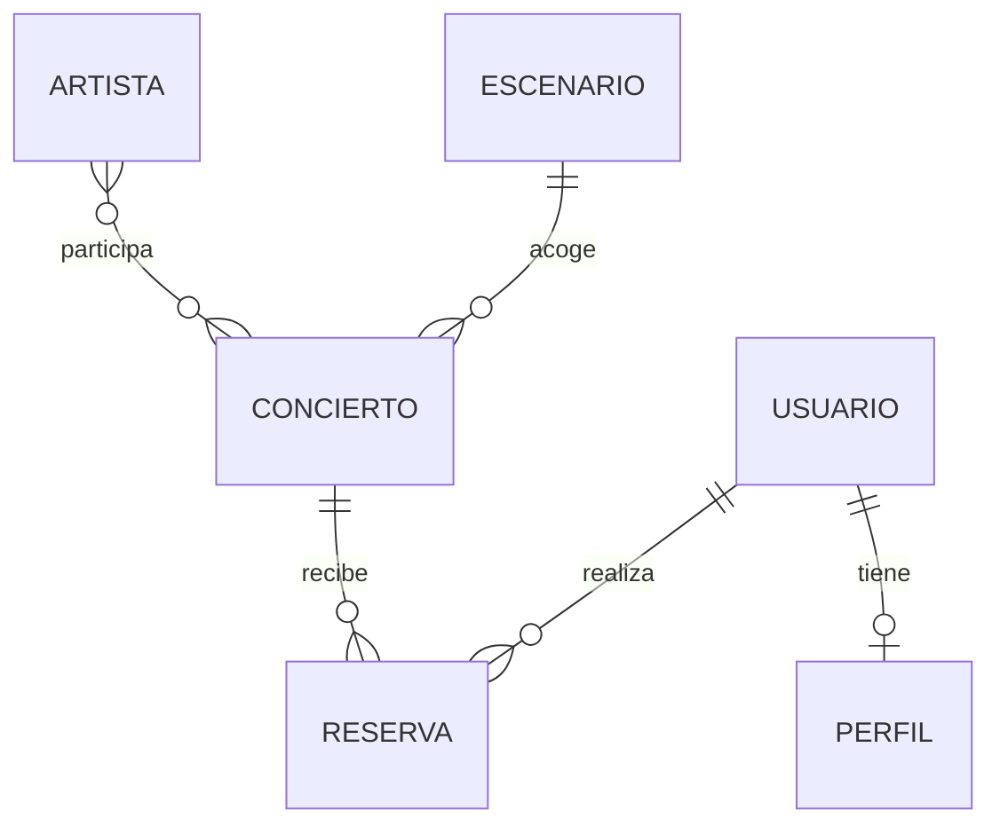

# Modelo de datos

## Diagrama

El usuario es el modelo de autenticación de Django (`settings.AUTH_USER_MODEL`).

## Modelos

| Modelo | Campos |
|---|---|
| `Artista` | `nombre` (único), `pais`, `genero_musical`, `fecha_creacion` (inicio de actividad), `cache`, `activo` |
| `Escenario` | `nombre` (único), `ubicacion`, `aforo`, `cubierto` |
| `Concierto` | `nombre`, `fecha_y_hora`, `duracion` (minutos), `precio`, `escenario`, `artistas`, `entradas_disponibles`, `cancelado`, `descripcion` |
| `Perfil` | `usuario`, `dni` (único), `telefono`, `fecha_nacimiento`, `localidad` |
| `Reserva` | `localizador` (único), `usuario`, `concierto`, `fecha_reserva`, `numero_entradas`, `importe_total`, `estado` |

- El dinero (`cache`, `precio`, `importe_total`) usa `DecimalField` para no tener errores de redondeo.
- `estado` usa `TextChoices`: se guarda `CON` o `CAN` y se muestra «Confirmada» o «Cancelada».
- `importe_total` se guarda en la reserva para conservar lo pagado aunque cambie el precio.

## Relaciones

| Campo | Tipo | `on_delete` | `related_name` | Justificación |
|---|---|---|---|---|
| `Concierto.escenario` | `ForeignKey` (1:N) | `PROTECT` | `conciertos` | No se puede borrar un escenario con conciertos programados |
| `Concierto.artistas` | `ManyToManyField` (N:M) | No tiene | `conciertos` | La relación no tiene datos propios, así que no necesita `through`. Al quitar la relación no se borra el artista |
| `Perfil.usuario` | `OneToOneField` (1:1) | `CASCADE` | `perfil` | El perfil no tiene sentido sin su usuario |
| `Reserva.usuario` | `ForeignKey` (1:N) | `PROTECT` | `reservas` | Se conserva el historial de ventas |
| `Reserva.concierto` | `ForeignKey` (1:N) | `PROTECT` | `reservas` | Un concierto con reservas no se puede eliminar |

Como `Perfil.usuario` usa `CASCADE` y `Reserva.usuario` usa `PROTECT`, un usuario sin reservas se borra junto con su perfil, y un usuario con reservas no se puede borrar.

## Restricciones e integridad

### En la base de datos

| Regla | Mecanismo |
|---|---|
| Nombre de artista y de escenario sin repetir | `unique=True` |
| DNI y localizador sin repetir | `unique=True` |
| Un perfil por usuario | `OneToOneField` |
| Aforo mayor que 0 | `CheckConstraint` |
| Duración mayor que 0 | `CheckConstraint` |
| Caché y precio no negativos | `CheckConstraint` |
| Entradas disponibles no negativas | `PositiveIntegerField` |
| Al menos una entrada por reserva | `CheckConstraint` |
| Importe no negativo | `CheckConstraint` |

### En el ORM de Django

| Regla | Mecanismo |
|---|---|
| No eliminar un concierto con reservas | `on_delete=models.PROTECT` (lanza `ProtectedError`) |

### Lógica de la aplicación

| Regla | Dónde |
|---|---|
| No reservar en un concierto cancelado | `realizar_reserva` |
| No vender más entradas de las disponibles | `realizar_reserva`, con `atomic()` y `select_for_update()` |
| No cancelar dos veces una reserva | `cancelar_reserva` |
| Reservas confirmadas coherentes con la disponibilidad | Carga inicial y funciones de `services.py` |
| Disponibles sin superar el aforo | Ver el apartado siguiente |
| No cambiar el escenario de un concierto con reservas | Comprobación en la operación CRUD 7; en el admin el escenario no se puede editar |

### Disponibles y aforo

Esta regla compara dos tablas, por lo que no se puede declarar con un `CheckConstraint` en `Concierto`. Se mantiene porque:

- La disponibilidad inicial se toma del aforo del escenario.
- `realizar_reserva` solo resta entradas y `cancelar_reserva` solo devuelve las de una reserva confirmada.
- En el admin, `entradas_disponibles` no se puede editar después de crear el concierto.

**Limitaciones conocidas:** no hay una validación en el modelo (decisión tomada en clase). Al **crear** un concierto desde el admin, o al modificar datos directamente con el ORM, se puede indicar una cifra mayor que el aforo. Tampoco se recalcula la disponibilidad si se cambia el aforo de un escenario. Marcar un concierto como cancelado no cancela sus reservas.
